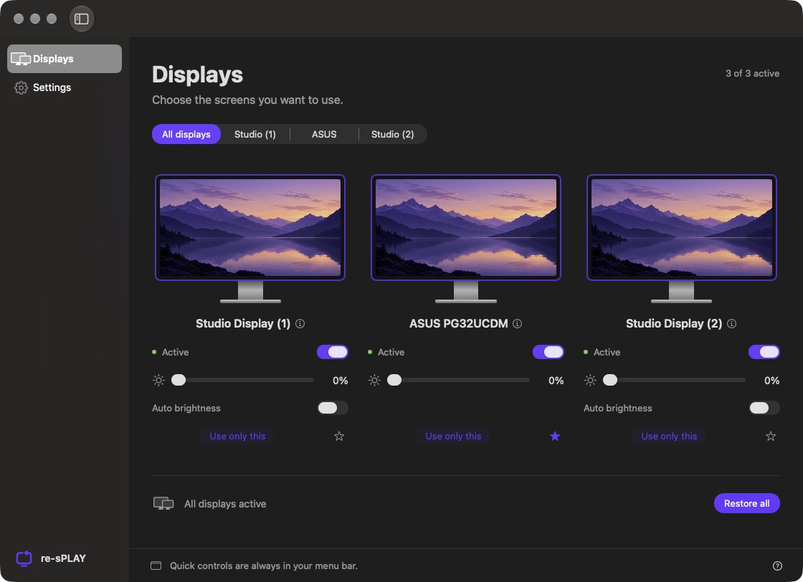
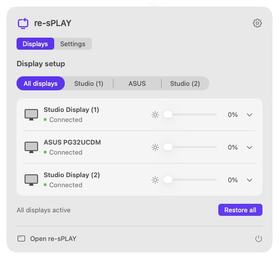

# re-sPLAY

[](docs/images/readme-banner.png)

A native macOS menu bar app for choosing which displays to use—without unplugging cables.

Use one monitor exclusively, restore your workspace, and adjust each display’s brightness from a compact SwiftUI interface. Built for macOS 27+ on Apple silicon. Current version: **0.8.2**.

## Features

- **Use only this:** activate any connected display and disconnect the others in software.
- **Individual display controls:** connect or disconnect a monitor while keeping at least one display active.
- **Restore all:** reconnect displays disabled by re-sPLAY, from the window, menu bar, or keyboard.
- **Independent brightness:** native macOS brightness for supported displays, including Apple Studio Displays and the ASUS PG32UCDM with HDR enabled; DDC/CI fallback where supported.
- **Auto brightness:** toggle macOS ambient-light adjustment independently on supported displays.
- **Global shortcuts:** choose a preferred display, switch to it, and restore your workspace from other apps.
- **Launch at login:** start quietly in the menu bar.
- **Native interface:** a sidebar-based window with monitor previews, active switches, brightness controls, and a separate Settings page.
- **Menu-bar Quick Controls:** Displays and Settings tabs, single-display presets, brightness sliders, and expandable per-display controls.

Display disconnection requests standby; it does not cut AC power. Actual standby behavior depends on the monitor and connection. This is an independent implementation with no Lunar installation, subscription, code, or assets required.

## Preview

The main window above is a real capture of version 0.8.2. It follows the system's light or dark appearance. [View the light appearance](docs/images/app-light.png). [View the expanded layout with the sidebar collapsed](docs/images/sidebar-collapsed.png).

Quick Controls keeps display switching and brightness in the menu bar:



## Requirements

- An Apple silicon Mac running macOS 27 or later.
- Xcode or Command Line Tools providing Swift and the macOS 27 SDK to build.
- A supported display connection. Tested with an M4 Max MacBook Pro, two Apple Studio Displays, an ASUS PG32UCDM, and CalDigit TS4 docks on macOS 27.0.1.

The app uses private macOS display APIs resolved at runtime. Compatibility with other hardware and future macOS versions is not guaranteed. See [verification notes and limitations](TESTING.md).

## Build and install

```sh
git clone https://github.com/tskelt0n/re-sPLAY.git
cd re-sPLAY
./build.sh
```

The build generates:

```text
build/
├── re-sPLAY.app
└── re-sPLAY-macOS27.zip
```

The app is ad-hoc signed locally and its signature is verified before packaging. No paid Apple developer account or third-party package manager is required. This build is not Developer ID signed or notarized.

Quit any running copy before replacing it, then install from the archive:

```sh
mkdir -p "$HOME/Applications"
ditto -x -k build/re-sPLAY-macOS27.zip "$HOME/Applications"
open "$HOME/Applications/re-sPLAY.app"
```

Enable **Launch at login** in the app if desired. Keep the installed app at a stable location for login registration. Click its menu-bar icon for Quick Controls without bringing the main window forward, or choose **Open re-sPLAY** to show the main window. Right-click the menu-bar icon for the compact command menu.

## Using re-sPLAY

The **Displays** page presents one monitor preview per display. Columns follow the actual display count and available width: collapsing the sidebar expands the previews and controls, while narrow windows wrap them into fewer columns. The Active switch connects or disconnects it, the star selects the shortcut target, and the info button explains its controls. Preview wallpaper is bundled illustrative artwork, not a live screen capture.

The **Display setup** segmented control switches between all displays and a single monitor. These controls act immediately; there is no separate Apply step. **Settings** contains the shortcut target and launch-at-login preference.

Quick Controls offers the same display presets and brightness sliders directly in the menu-bar popover. Expand a monitor row for its Active switch, auto brightness when supported, and shortcut preference. Its Settings tab and gear button let you adjust startup and shortcut preferences without opening the window. While re-sPLAY is focused, **Command–Shift–D** opens Quick Controls and **Command–comma** opens Settings.

Choose **Use only this** to connect that display if necessary, then disconnect the others. This also makes it the shortcut target. The Active switch controls an individual display; re-sPLAY refuses to disconnect the last active display. **Restore all** reconnects displays disabled by this app. Quitting normally also restores those displays.

| Shortcut | Action |
| --- | --- |
| Control–Option–Command–1 | Toggle the preferred display exclusively; press again to restore |
| Control–Option–Command–0 | Restore all displays disabled by re-sPLAY |

Use the top-row number keys. Shortcuts work while the app is running and do not require Accessibility or Input Monitoring permission. Conflicts with other apps are reported in the window.

Switching through Thunderbolt docks can take several seconds. A toggle pressed during the transition is queued; repeated presses coalesce into one pending toggle. Restore All cancels a pending toggle. When switching to an inactive display, the app confirms it is active before disconnecting the others.

### Brightness and HDR

The 0–100% slider prefers macOS’s native brightness control whenever the display supports it. On the ASUS PG32UCDM with HDR enabled, it controls the same brightness value as **System Settings → Displays**. This is separate from the monitor’s DDC luminance setting, which can acknowledge changes without visibly changing its HDR picture.

For displays without native brightness support, re-sPLAY falls back to DDC/CI luminance control when HDR is not detected as enabled. DDC/CI must be enabled on the monitor. The app does not silently substitute DDC after a native-control error, change HDR settings, apply a dark overlay, or modify gamma tables.

Brightness is read on launch, reconnection, and approximately every 15 seconds. Writes are debounced, serialized off the UI thread, and checked with a readback. External changes appear on the next refresh. Zero means minimum brightness, not power off; equal percentages on different monitors need not look equally bright.

Turn **Auto brightness** off on a Studio Display to keep a manually chosen level. Moving its slider does not change that preference. Auto brightness reflects macOS’s ambient-light setting, and macOS owns its persistence. The ASUS does not expose this ambient-light control.

## Diagnostics and recovery

Run diagnostics against the installed app:

```sh
APP="$HOME/Applications/re-sPLAY.app/Contents/MacOS/re-sPLAY"
"$APP" --diagnose
"$APP" --brightness-status
"$APP" --auto-brightness-status
"$APP" --login-status
"$APP" --shortcut-status
```

The following commands change display state. Replace `DISPLAY_UUID` with an identifier from `--diagnose`:

```sh
"$APP" --restore
"$APP" --brightness-set DISPLAY_UUID 50
"$APP" --auto-brightness-set DISPLAY_UUID off
```

If brightness is unavailable, use **Retry** and check the display’s connection, HDR mode, and DDC/CI support. If macOS cannot reconnect a display, reconnecting its cable or restarting the Mac remains a recovery option. The app remembers the displays it disabled, but does not enforce disconnection across sleep/wake.

## Project structure

| File | Responsibility |
| --- | --- |
| [Sources/main.swift](Sources/main.swift) | Display engine, menu bar, shortcuts, login registration, and diagnostics |
| [Sources/DisplayWindow.swift](Sources/DisplayWindow.swift) | Sidebar window, settings, shared display controls, and view model |
| [Sources/MenuPopover.swift](Sources/MenuPopover.swift) | Tabbed menu-bar Quick Controls |
| [Sources/BrandArtwork.swift](Sources/BrandArtwork.swift) | Shared return-frame logo drawing |
| [Sources/Brightness.swift](Sources/Brightness.swift) | Native brightness, DDC/CI, auto brightness, and background I/O |
| [Scripts/GenerateIcon.swift](Scripts/GenerateIcon.swift) | App icon and brand export using the shared logo drawing |
| [build.sh](build.sh) | Compilation, app bundle assembly, signing, and ZIP packaging |
| [TESTING.md](TESTING.md) | Verification evidence and manual checks |

The shell script is the authoritative build path; an Xcode project and Swift package manifest are not required. Build outputs are ignored by Git.

The internal bundle identifier remains `local.DisplaySwitch` to preserve preferences, display labels, recovery state, and login registration from earlier versions. The product name is **re-sPLAY**. The new purple return-frame identity is documented in [brand assets](docs/brand/README.md).

Workspace saving and restoration of other apps’ window positions are planned separately and are not included in this version.

## License

[MIT](LICENSE). API and protocol references are documented in [THIRD_PARTY_NOTICES.md](THIRD_PARTY_NOTICES.md).
